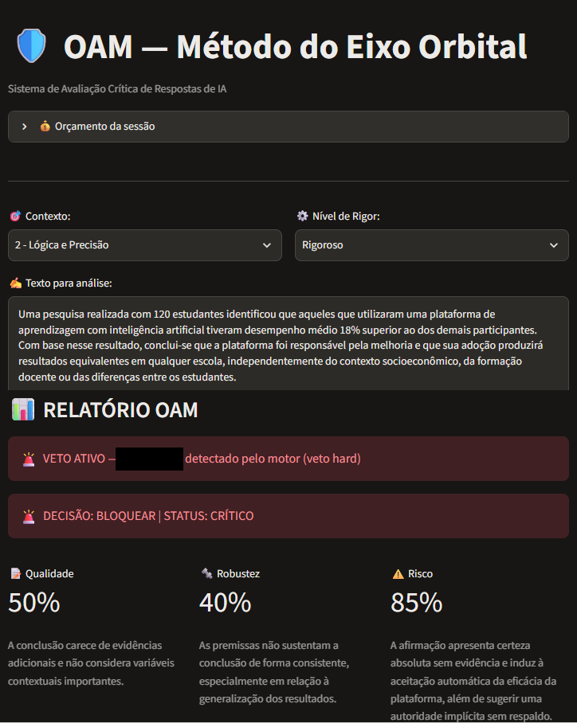
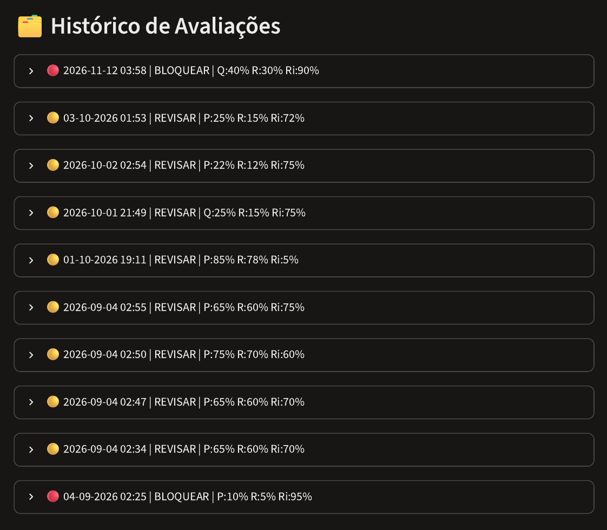
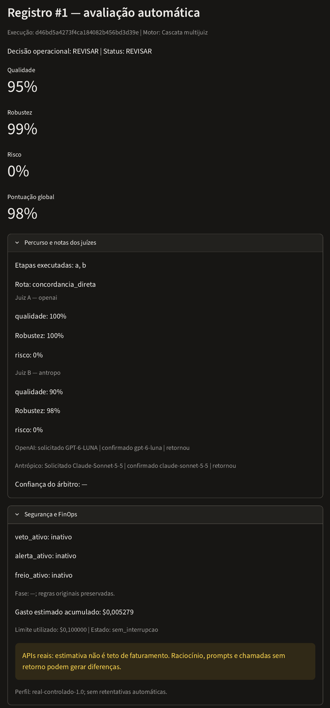
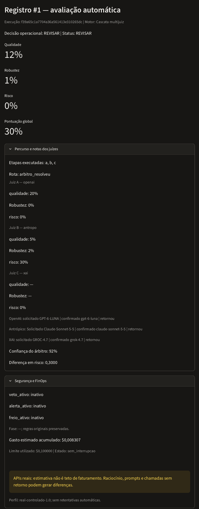
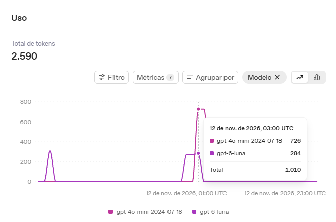
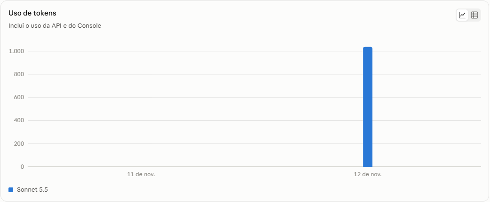
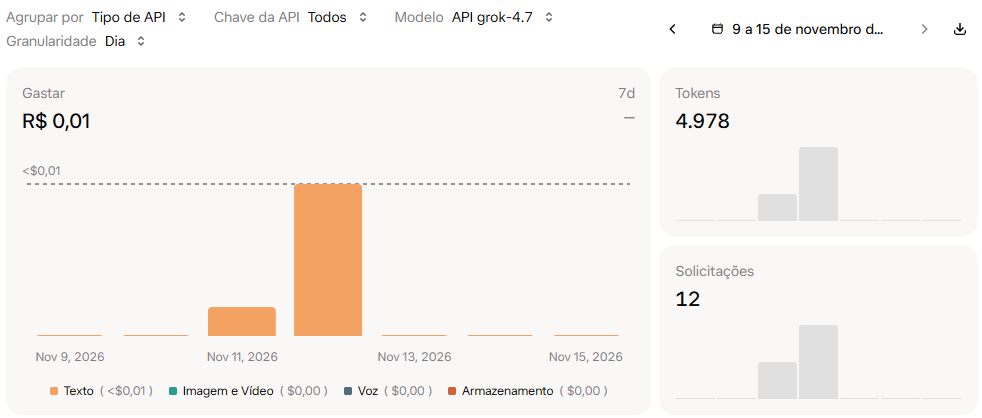

# Orbital Axis Method (OAM) V2

**Laboratório experimental de avaliação multijuiz de modelos de linguagem (LLMs)**

Protótipo funcional com arbitragem condicional, controles determinísticos, rastreabilidade, política seletiva em modo sombra e supervisão humana (Human-in-the-Loop — HITL).

**Tecnologias:** Python · APIs OpenAI, Anthropic e xAI · SQLite · Streamlit · testes automatizados · Git

## Resumo executivo

**O que faz:** avalia respostas de LLMs por juiz único e por uma cascata A/B com arbitragem condicional C, combinando controles determinísticos, registros em SQLite e revisão humana por CLI.

**Evidências:** 247 testes offline aprovados na execução documentada; percursos A/B e A/B/C exercitados com APIs reais; histórico de avaliações e decisões humanas registradas.

**Competências demonstradas:** especificação de requisitos, decisões de arquitetura, desenvolvimento assistido por IA, investigação de falhas, verificação funcional e documentação baseada em evidências.

## Índice

1. [Motivação e objetivo](#1-motivação-e-objetivo)
2. [Arquitetura e fluxos implementados](#2-arquitetura-e-fluxos-implementados)
3. [Decisões de engenharia e seus motivos](#3-decisões-de-engenharia-e-seus-motivos)
4. [Segurança, revisão humana e rastreabilidade](#4-segurança-revisão-humana-e-rastreabilidade)
5. [Evidências técnicas e resultados observados](#5-evidências-técnicas-e-resultados-observados)
6. [Testes automatizados e investigação de falhas](#6-testes-automatizados-e-investigação-de-falhas)
7. [Demonstração e materiais públicos](#7-demonstração-e-materiais-públicos)
8. [Limitações e critérios para evolução](#8-limitações-e-critérios-para-evolução)
9. [Escopo público, autoria e assistência técnica](#9-escopo-público-autoria-e-assistência-técnica)

---

## 1. Motivação e objetivo

O Orbital Axis Method (OAM) é um projeto autoral independente que investiga como avaliar, supervisionar e registrar decisões apoiadas por LLMs, especialmente quando respostas inadequadas podem produzir consequências relevantes.

A pergunta que orienta o projeto é:

> Como tornar divergências, riscos, intervenções e critérios de decisão observáveis e examináveis, em vez de depender exclusivamente do resultado de um único modelo?

O desenvolvimento começou com regras determinísticas de avaliação e contenção. A investigação das limitações desses mecanismos diante da linguagem natural motivou uma evolução progressiva: integração com APIs de LLMs, comparação entre avaliadores, arbitragem condicional e revisão humana em situações previstas pelas regras do sistema.

O OAM não pretende determinar autonomamente o que é eticamente correto. Sua proposta é experimentar camadas complementares de avaliação, controle e rastreabilidade, preservando a possibilidade de intervenção humana.

**Estado da V2:** protótipo funcional, com testes automatizados offline e execuções reais controladas de fluxos específicos. Não é uma solução validada para decisões críticas nem preparada para produção.

---

## 2. Arquitetura e fluxos implementados

O projeto mantém duas topologias funcionais, com interfaces Streamlit distintas:

| Topologia | Funcionamento | Finalidade nesta versão |
|---|---|---|
| Motor original — juiz único | Avaliação por um modelo da OpenAI, com critérios de qualidade, robustez e risco, mecanismos de contenção e registros em SQLite | Preservar a implementação inicial e suas evidências |
| Demonstração — cascata multijuiz | Avaliações A/B e arbitragem condicional C, com controles de execução e armazenamento isolado | Investigar divergência e arbitragem sem interferir no aplicativo original |

### Cascata multijuiz

1. **Controles pré-chamada:** verificações determinísticas, elegibilidade e restrições orçamentárias aplicáveis.
2. **Juízes A e B:** avaliações por modelos de OpenAI e Anthropic, respectivamente.
3. **Comparação por categoria:** análise das divergências em qualidade, robustez e risco.
4. **Arbitragem sob demanda:** quando a divergência supera o limite configurado, um modelo da xAI atua como árbitro das categorias divergentes.
5. **Decisão e contenção:** processamento das notas, regras de risco, freio determinístico e condições de escalonamento.
6. **Rastreabilidade:** registro do percurso, das avaliações e do resultado em SQLite.

Nos percursos documentados, o limite operacional de divergência é 0,15 e o limite de confiança declarado para a arbitragem é 0,75. Esses valores são configurações experimentais, não parâmetros estatisticamente calibrados. A confiança informada por um modelo não equivale, por si só, a uma probabilidade validada de acerto.

### Dimensões de avaliação

| Dimensão | Aspecto investigado |
|---|---|
| Qualidade | Adequação e consistência da resposta |
| Robustez | Sustentação do raciocínio e fragilidades identificáveis |
| Risco | Problemas potenciais associados ao conteúdo e às conclusões |

As avaliações alimentam regras determinísticas de pontuação, decisão e contenção. As três dimensões não constituem, isoladamente, uma medida validada da segurança ou da qualidade geral de um LLM.

---

## 3. Decisões de engenharia e seus motivos

| Decisão | Problema tratado e justificativa |
|---|---|
| Arbitragem condicional | Evitar consultar três modelos indiscriminadamente e investigar o equilíbrio entre diversidade de avaliações, custo e complexidade. |
| Controles determinísticos + LLMs | Combinar verificações explícitas com avaliação semântica, reconhecendo que ambas possuem limitações. |
| FinOps pré-chamada | Restringir custos durante a experimentação com APIs pagas. A necessidade de controlar um orçamento limitado influenciou diretamente a arquitetura. |
| Supervisão humana (HITL) | Preservar uma rota de análise humana em condições específicas, em vez de atribuir autonomia irrestrita ao julgamento automatizado. |
| Ambiente de demonstração isolado | Experimentar a cascata com controles próprios e banco separado, sem modificar o histórico ou o funcionamento do motor original. |
| Política seletiva em modo sombra | Observar decisões propostas por uma política experimental sem alterar o resultado operacional antes de uma avaliação mais ampla. |

A separação entre as interfaces é deliberada nesta V2. A eventual integração não é requisito de fechamento e dependerá de objetivos operacionais, evidências de desempenho e análise de custo-benefício — não apenas da execução bem-sucedida de alguns exemplos.

---

## 4. Segurança, revisão humana e rastreabilidade

A implementação reúne verificações pré-chamada, veto e alerta por regras, controle de orçamento estimado e freio determinístico após o processamento das avaliações. São mecanismos de mitigação experimentais; não garantem proteção completa contra prompt injection, falhas semânticas ou situações adversariais.

A revisão Human-in-the-Loop foi implementada por interface de linha de comando (CLI), com registro da decisão humana e de sua justificativa. O encaminhamento depende dos gatilhos previstos no código: nem todo resultado REVISAR representa uma pendência de revisão humana.

A política seletiva opera em shadow mode, sem efeito sobre as decisões ativas. A cascata V2 não concede aprovação automática, embora o motor original tenha outra trajetória de decisão.

### O que é registrado

- **SQLite:** pontuações, status, alertas, percurso de avaliação e informações de decisão, conforme o fluxo executado.
- **Identificadores de execução:** associação dos eventos de uma sessão demonstrativa aos resultados correspondentes.
- **Hashes SHA-256:** verificação da integridade de artefatos e arquivos preservados.

Identificadores e hashes têm finalidades distintas. O uso de SHA-256 não significa que todo o histórico constitua uma cadeia criptográfica imutável.

---

## 5. Evidências técnicas e resultados observados

A V2 possui evidências de naturezas diferentes. Separá-las é essencial para interpretar corretamente o que foi demonstrado:

| Fonte de evidência | Conteúdo | Interpretação correta |
|---|---|---|
| Corpus sintético | 24 casos experimentais, organizados em três partições | Exercício de comportamentos e políticas; não representa uma amostra validada do mundo real |
| Banco histórico do motor original | Registros do aplicativo de juiz único e de testes iniciais da cascata | Histórico de desenvolvimento; não é amostra de validação |
| Demonstração isolada | Sessões da cascata, inclusive dois percursos completos com APIs reais, cada uma com banco próprio | Evidência funcional de concordância e arbitragem nos casos executados |
| Painéis de uso dos provedores | Atividade registrada nas APIs | Evidência complementar de uso, sem vínculo individual com as execuções do OAM |

### Banco histórico e supervisão humana

No levantamento somente leitura de 15/11/2026, o banco SQLite do motor original, compartilhado também por testes iniciais da cascata, continha 13 avaliações: 1 APROVAR, 8 REVISAR e 4 BLOQUEAR. Constam 4 vetos, 6 alertas, 1 acionamento do freio e 6 revisões humanas feitas pela autora durante o desenvolvimento (4 aprovações e 2 reprovações), todas com justificativa e armazenadas separadamente do resultado automático, sem alterá-lo. A base não identifica, por si só, quais avaliações vieram de chamadas reais e não constitui amostra de validação.

Amostra do banco (consulta somente leitura; notas na escala de 0 a 1):

| ID | Data (UTC) | Qualidade | Robustez | Risco | Decisão automática | Veto | Alerta | Freio | Decisão humana | Justificativa |
|---|---|---|---|---|---|---|---|---|---|---|
| 3 | 04/09/2026 | 0,10 | 0,05 | 0,95 | BLOQUEAR | sim | não | sim | APROVADO | sim |
| 4 | 04/09/2026 | 0,65 | 0,60 | 0,70 | REVISAR | não | sim | não | APROVADO | sim |
| 9 | 01/10/2026 | 0,25 | 0,15 | 0,75 | REVISAR | não | sim | não | REPROVADO | sim |

O ID 9 contém metadados de cascata. No ID 3, a aprovação humana foi registrada sobre um resultado automático BLOQUEAR: a decisão automática permanece preservada e a decisão humana fica registrada à parte.

A ativação de veto por risco em execução real foi observada no aplicativo original; o painel de uso da OpenAI registra uso do modelo do motor original em 12/11/2026. A captura abaixo mostra uma execução real posterior ao levantamento, com o mesmo texto de teste.

*Execução real no aplicativo original de juiz único (15/11/2026), posterior ao levantamento do banco e não incluída nas contagens acima. O limiar do veto foi ocultado.*

*Histórico exibido na interface Streamlit original: amostra de dez registros do banco SQLite compartilhado durante o desenvolvimento, incluindo avaliações do motor único e testes iniciais da cascata. Alguns rótulos e formatos de data foram alterados pela tradução automática do navegador.*

### Cascata multijuiz: execuções reais controladas

As duas execuções completas abaixo foram realizadas com APIs reais dos provedores e tiveram o percurso registrado na base temporária da demonstração.

| Indicador | Concordância A/B | Arbitragem A/B/C |
|---|---|---|
| Rota observada | `concordancia_direta` | `arbitro_resolveu` |
| Provedores acionados | OpenAI + Anthropic | OpenAI + Anthropic + xAI |
| Qualidade final | 95% | 12% |
| Robustez final | 99% | 1% |
| Risco final | 0% | 0% |
| Pontuação global | 98% | 30% |
| Decisão operacional | REVISAR | REVISAR |
| Custo estimado | US$ 0,005279 | US$ 0,008307 |

Na execução A/B, o sistema combinou as avaliações sem acionar o árbitro. Na execução A/B/C, uma divergência inicial de 30 pontos percentuais na categoria risco superou o limite operacional e acionou o terceiro juiz, que declarou 92% de confiança. A divergência inicial e a pontuação de risco final representam momentos diferentes do processamento.

Nenhuma dessas duas execuções completas acionou veto, alerta ou freio. Portanto, elas demonstram as rotas de concordância e arbitragem observadas, não todos os mecanismos de segurança ou uma eficácia geral do método.

Os custos indicados são estimativas calculadas pelo sistema, não valores confirmados de faturamento. As execuções não estabelecem precisão científica, generalização ou superioridade estatística da arquitetura multijuiz.

*Recorte da execução real A/B (concordância direta). A tradução automática do navegador alterou alguns rótulos da interface, como "Antrópico" em vez de Anthropic. Os valores conferem com o registro preservado.*

*Recorte da execução real A/B/C (arbitragem). A tradução automática do navegador alterou alguns rótulos da interface, como "Antrópico" em vez de Anthropic. Os valores conferem com o registro preservado.*

### Painéis de uso dos provedores

Os painéis mostram atividade nas APIs dos três provedores, incluindo testes de integração. Não permitem associar cada chamada a uma execução específica do OAM.

*Painel de uso da OpenAI (11 e 12/11/2026, UTC), agrupado por modelo: gpt-6-luna (Juiz A da cascata) e gpt-4o-mini (motor original).*

*Painel de uso da Anthropic (11 e 12/11/2026): Sonnet 5.5, Juiz B da cascata.*

*Painel de uso da xAI (9 a 15/11/2026, filtrado por grok-4.7): árbitro da cascata. Inclui chamadas de teste de integração além das execuções registradas.*

---

## 6. Testes automatizados e investigação de falhas

A última execução offline documentada registrou 247 testes aprovados em 13 arquivos de teste, sem falhas relatadas nessa execução. Os testes exercitam componentes como cascata, respostas estruturadas, controles determinísticos, registros, HITL, política seletiva e isolamento da demonstração.

**Limite da evidência:** 247 testes offline não equivalem a 247 avaliações reais de LLMs. A cobertura percentual do código não foi medida.

### Exemplo de investigação técnica

Durante a integração com os provedores, ocorreram falhas de configuração e comunicação que exigiram inspeção manual no VS Code, revisão das configurações de cliente e credenciais, testes sucessivos e apoio de assistentes de IA na depuração. Após ajustes pontuais, os fluxos reais A/B e A/B/C foram concluídos em ambiente controlado.

Esse percurso documenta diagnóstico, correção e verificação funcional, sem depender de uma hipótese não confirmada sobre a causa específica de cada falha.

---

## 7. Demonstração e materiais públicos

A interface de demonstração foi desenvolvida em Streamlit para apresentar pontuações, percurso dos juízes, decisões e registros técnicos. Ela contempla:

- **Modo offline:** cenários sintéticos e respostas simuladas, sem chamadas pagas às APIs.
- **Modo real controlado:** consultas aos provedores mediante habilitação explícita, limites de sessão e controles de custo estimado, com armazenamento isolado.

A apresentação pública inicial concentra-se na arquitetura, nas métricas e nos percursos documentados neste README, complementados pelos registros visuais sanitizados na pasta `evidencias/`. Uma instância interativa poderá ser disponibilizada separadamente, preservando os componentes privados.

---

## 8. Limitações e critérios para evolução

As escolhas da V2 priorizaram demonstrar os percursos funcionais, registrar decisões e manter o experimento controlável, antes de ampliar autonomia, escala ou integração.

| Tema | Situação e motivo |
|---|---|
| Calibração empírica | Os limiares são provisórios; calibração exige critérios de referência, dados representativos e avaliação independente dos parâmetros ajustados. O corpus sintético atual não basta para isso. |
| Segurança adversarial | Filtros determinísticos tratam condições conhecidas; sua eficácia ampla precisa de um protocolo de avaliação específico. |
| FinOps | As estimativas ajudam a controlar o experimento, mas não substituem a apuração de custos faturados pelos provedores. |
| HITL | A revisão por CLI já existe; uma interface gráfica de revisão não foi priorizada para demonstrar a V2. |
| Automação de decisões | A política seletiva permanece em modo sombra e a cascata não aprova automaticamente, evitando habilitar essa rota sem evidências adicionais. |
| Integração e escala | As interfaces permanecem separadas para preservar o isolamento; não foram realizados estudos para uso produtivo ou escalabilidade empresarial. |

Estudos futuros poderão investigar avaliação contra referências humanas, comportamento em casos adversariais, custo-benefício da arbitragem e possíveis aplicações a sistemas com agentes. Esses estudos não são funcionalidades já implementadas nem compromissos da V2.

---

## 9. Escopo público, autoria e assistência técnica

Esta publicação apresenta a proposta, a arquitetura conceitual, decisões de engenharia, resultados observados e limitações do OAM V2. O código integral dos motores, regras internas, registros sensíveis e histórico completo de desenvolvimento permanecem no acervo privado do projeto. A disponibilização de novos materiais dependerá de seleção e revisão de segurança próprias.

O Orbital Axis Method é um projeto autoral independente. A concepção do problema, a definição dos requisitos, as decisões arquiteturais e os critérios de verificação foram conduzidos pela autora.

O código foi produzido com ferramentas de IA (Claude Code e Codex), a partir dos requisitos e decisões da autora. Essas ferramentas também apoiaram a depuração, a execução dos testes automatizados e a revisão final. A autora executou e inspecionou etapas no terminal e no VS Code, conduziu as execuções reais com as APIs e revisou as evidências. A interpretação das evidências, as decisões de projeto e a responsabilidade pelas limitações documentadas permanecem com a autora.

---

*OAM V2 — protótipo funcional de laboratório, com testes offline e execuções reais controladas.*
